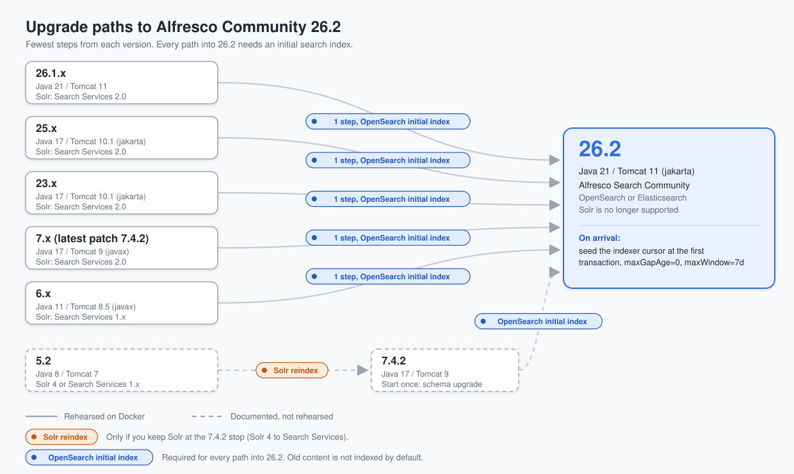

# Alfresco Community upgrade rehearsal

Tools to rehearse an upgrade of Alfresco Community Edition to 26.2 on Docker, with your own data or with a generated test data set, and to check add-ons (JARs and AMPs) against the target version.

The upgrade path and every manual step are explained in [docs/upgrade-path.md](docs/upgrade-path.md).



## Tested upgrade paths

Each source repository was created from data seeded on 6.1.2 and upgraded with the steps in the guide. Every row passed all checks: users, sites, version history, comments, tags, properties, content checksums, new upload, PDF rendition, and full-text search on old and new content.

| From | To | Steps | Result |
| --- | --- | --- | --- |
| 6.1.2 | 26.2.0 | 1 | PASS |
| 7.4.2 | 26.2.0 | 1 | PASS |
| 23.4.1 | 26.2.0 | 1 | PASS |
| 25.3.0 | 26.2.0 | 1 | PASS |
| 26.1.0 | 26.2.0 | 1 | PASS |
| 6.1.2, history moved back 2 years | 26.2.0 | 1 | PASS with the initial-index procedure; FAIL (old content not indexed) with default settings |

Other results:

- Share and Content App on an upgraded 26.2: login, site dashboard, document library and thumbnail work.
- An add-on built for `javax.servlet` stops the 26.2 repository from starting (`NoClassDefFoundError: javax/servlet/Filter`); the same add-on built for `jakarta` loads.
- Add-ons from the alfresco-docker-installer catalog against 6.1 to 26.2: [test/results/addons.md](test/results/addons.md).

Raw results are in [test/results](test/results). The test method is in [docs/test-plan.md](docs/test-plan.md).

## Requirements

- Docker with Docker Compose v2, 16 GB of memory for Docker.
- Node.js 18 or later (to generate environments with alfresco-docker-installer).
- Python 3, Java 17 or later (for the add-on check).

## Quick start

```bash
# 1. Generate the environments with alfresco-docker-installer
git clone https://github.com/Alfresco/alfresco-docker-installer.git /tmp/alfresco-docker-installer
(cd /tmp/alfresco-docker-installer && npm ci)
for v in 6.1 7.4 23.4 25.3 26.1 26.2; do
  node scripts/gen-env.mjs /tmp/alfresco-docker-installer $v test/envs/$v
done

# 2. Run the whole matrix (about one hour)
BATCH_INDEXER_TAG=5.9.0 test/run-matrix.sh
```

The environments in `test/envs` are already generated. Changes made after generation:

- 7.4 uses 7.4.2 (latest 7.4 patch) and the official `alfresco/` images.
- Every environment has a `docker-compose.override.yml` that publishes the repository on port 8081 for the test scripts.
- In 26.2 the override also sets `node.store.allow_mmap=false` for OpenSearch. On Docker Desktop for Mac, OpenSearch with a bind-mounted data folder otherwise crashes with "a fault occurred in an unsafe memory access operation".
- The 26.2 template pins batch indexer 5.7.0. The tests use 5.9.0: set `BATCH_INDEXER_TAG=5.9.0` in the shell (as above) or in `test/envs/26.2/.env`.

## Rehearse with your own data

1. Put a PostgreSQL dump (`pg_dump -Fc`) and a copy of `alf_data` in `test/snapshots/<name>/alfresco.dump` and `test/snapshots/<name>/alf-repo-data`.
2. Run one upgrade step:

   ```bash
   test/upgrade.sh restore <name> 26.2
   test/upgrade.sh start 26.2
   test/upgrade.sh reindex 26.2
   ```

3. Check your own content in the Content App or Share (`test/smoke-ui.sh 26.2 <label>` starts them on http://localhost:8080).

`test/upgrade.sh verify` and `test/upgrade.sh search` expect the generated test data set, so use your own checks for your data.

## Scripts

| Script | Purpose |
| --- | --- |
| `test/upgrade.sh` | Start, seed, verify, search, initial index, snapshot and restore one environment |
| `test/run-hop.sh` | One upgrade step from a snapshot: restore, start, verify, initial index, search |
| `test/run-matrix.sh` | All upgrade steps from a new 6.1.2 repository; writes `test/results/matrix.txt` |
| `test/smoke-ui.sh` | Share and Content App checks on an upgraded environment |
| `test/extension-check/run.sh` | Deploys a `javax` or `jakarta` probe extension on 26.2 |
| `scripts/gen-env.mjs` | Runs alfresco-docker-installer without prompts |
| `scripts/build-inventories.sh` | Builds Extension Inspector inventories from the Community repository and Share images |
| `scripts/addon-check.sh` | Checks a JAR or AMP: Java version, bundled JARs, Extension Inspector against Community inventories |
| `test/addon-matrix.sh` | Runs the add-on check for a folder of add-ons and several versions |

## Check an add-on

```bash
curl -O https://artifacts.alfresco.com/nexus/repository/releases/org/alfresco/extension-inspector/alfresco-extension-inspector/2.8.0/alfresco-extension-inspector-2.8.0.jar
scripts/build-inventories.sh alfresco-extension-inspector-2.8.0.jar
scripts/addon-check.sh alfresco-extension-inspector-2.8.0.jar my-addon.amp 26.2
```

To repeat the add-on table, copy the add-ons from the alfresco-docker-installer clone (they are not stored here):

```bash
A=/tmp/alfresco-docker-installer/generators/app/templates/addons
mkdir -p test/addons/repo test/addons/share
cp $A/amps/*.amp $A/jars/simple-ocr-repo-*.jar $A/alfresco-tengine-ocr/*.jar test/addons/repo/
cp $A/amps_share/*.amp test/addons/share/
test/addon-matrix.sh alfresco-extension-inspector-2.8.0.jar test/addons 6.1 7.4 23.4 25.3 26.1 26.2
```

## Limits

- There is no Community 5.2 Docker image, so 5.2 is not rehearsed.
- Only PostgreSQL was tested.
- Only Docker Compose deployments were tested.

## License

Apache License 2.0. See [LICENSE](LICENSE).
